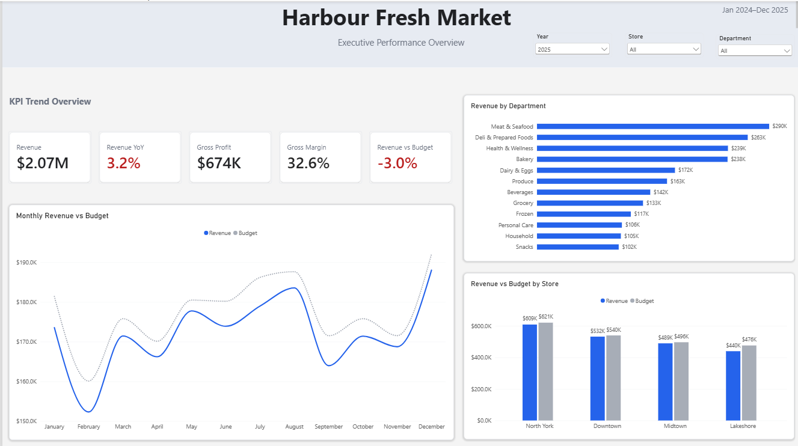
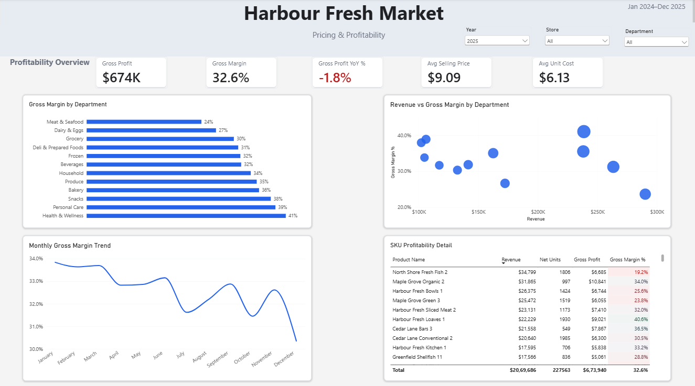
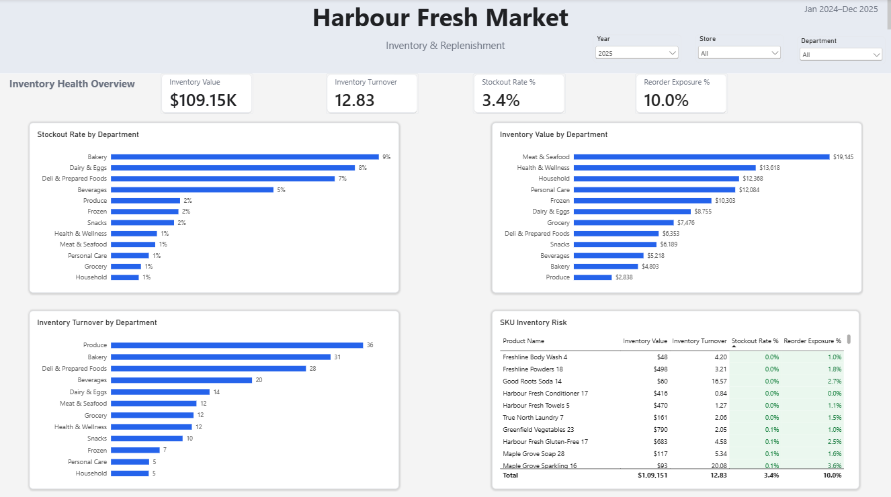
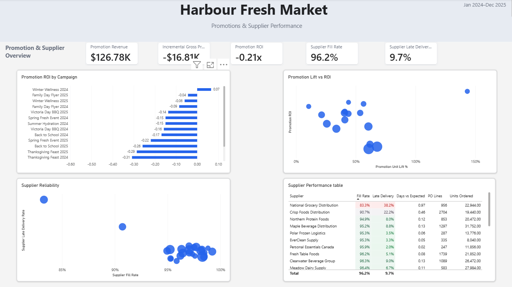

# Harbour Fresh Market — Retail Revenue & Inventory Analytics

An end-to-end retail analytics project built using MySQL, SQL and Power BI for a fictional Canadian grocery retailer.

The project analyzes more than 1.5 million synthetic records across 4 stores, 12 departments and 360 products.

## Business Problem

The objective was to understand whether revenue growth was translating into healthy profitability and inventory performance.

The analysis focuses on:

- Revenue and gross profit performance
- Pricing and margin trends
- Inventory and replenishment risk
- Supplier reliability
- Promotion effectiveness

## Dashboard

### Executive Overview

### Pricing & Profitability

### Inventory & Replenishment

### Promotions & Suppliers

## Key Findings

- 2025 revenue reached approximately $2.07M, increasing 3.2% YoY.
- Gross profit declined approximately 1.8% YoY despite revenue growth.
- Gross margin was approximately 32.6%.
- Revenue finished approximately 3.0% below budget.
- Meat & Seafood was among the lowest-margin departments.
- Inventory turnover was approximately 12.8x with a 3.4% overall stockout rate.
- Several individual products showed substantially higher stockout and reorder exposure.
- Overall promotion ROI was negative.
- Most suppliers performed well, while several showed weaker fill rates and higher late-delivery rates.

## Technical Work

### SQL

SQL was used for:

- Data validation
- NULL and duplicate checks
- Revenue and profitability analysis
- Budget variance analysis
- Inventory and replenishment analysis
- Supplier performance
- Promotion performance
- Reusable analytical views for Power BI

### Power BI

Built a four-page interactive dashboard:

1. Executive Overview
2. Pricing & Profitability
3. Inventory & Replenishment
4. Promotions & Suppliers

Created DAX measures for revenue, gross profit, gross margin, YoY growth, budget variance, inventory turnover, stockout rate, supplier fill rate, promotion lift and promotion ROI.

## Data Quality Example

During data loading, the product table initially loaded 352 records instead of the expected 360 because blank shelf-life values were not being handled correctly.

This also caused a dependent promotion table to load fewer records because of foreign-key relationships.

The issue was identified through row-count and referential-integrity checks. NULL handling was corrected during the SQL load process, the affected tables were reloaded, and the final record counts reconciled successfully.

## Tools

- MySQL
- SQL
- Power BI
- DAX
- Excel

## Data

All data used in this project is fully synthetic. No confidential or proprietary employer data is included.